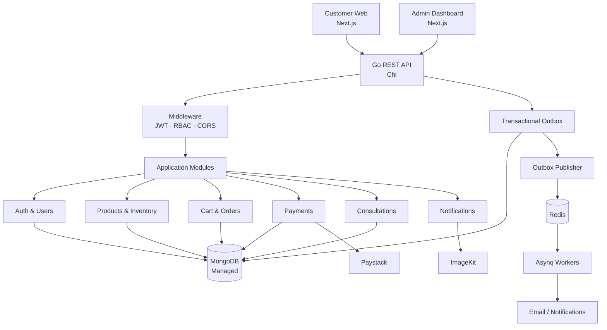

# Denisco Backend

Backend API for **Denisco Global Agriculture Ltd.**, powering its customer-facing website and admin dashboard.

Built with Go as a modular monolith, providing authentication, product management, inventory, order processing, payments, consultation bookings and notifications.

## Tech Stack

* **Language:** Go
* **Router:** Chi
* **Database:** MongoDB
* **Cache & Queues:** Redis, Asynq
* **Authentication:** JWT, bcrypt
* **Payments:** Paystack
* **File Storage:** ImageKit
* **API Documentation:** OpenAPI
* **Logging:** slog
* **Deployment:** Docker, Caddy

## Architecture



## Project Structure

```text
denisco_backend/
├── cmd/
│   ├── api/main.go              # HTTP server entry point
│   ├── worker/main.go           # Background job worker
│   └── outbox-publisher/main.go # Outbox → Redis publisher
├── internal/
│   ├── modules/                 # Business modules
│   │   ├── auth/ users/ products/ inventory/
│   │   ├── cart/ orders/ payments/ consultations/
│   │   └── notifications/ admin/
│   ├── platform/                # Cross-cutting infrastructure
│   │   ├── config/ database/ redis/ queue/
│   │   ├── events/ http/ middleware/ security/
│   │   └── storage/ logger/
│   └── bootstrap/               # Dependency wiring (api.go, worker.go)
├── api/                         # OpenAPI spec
├── scripts/                     # Index creation, seeding
├── tests/                       # Integration, e2e, concurrency
├── deployments/                 # Docker, Caddy, compose
├── .github/workflows/           # CI/CD
├── .env.example
├── go.mod
├── Makefile
└── README.md
```

## Getting Started

**Requirements**

* Go 1.27+
* MongoDB (Atlas, or a local replica set — transactions require one)
* Redis 7+ (optional for the API, required for the worker and outbox publisher)
* Docker (optional, for the deployment stack)

**Setup**

```bash
git clone <repository-url>
cd denisco_backend

cp .env.example .env
```

Fill in the required variables. The API refuses to start when any of these is
missing or invalid:

| Variable | Notes |
| --- | --- |
| `MONGODB_URI` | Atlas `mongodb+srv://…` connection string |
| `WEB_ORIGIN`, `ADMIN_ORIGIN` | Exact origins; wildcards are rejected |
| `JWT_ACCESS_SECRET` | At least 32 characters |

Then start the API:

```bash
make run-api
```

Indexes are created on every boot, so no separate migration step is needed.

**Create the first administrator**

Administrative roles are never grantable through the public API, so the initial
admin is provisioned with a script. The password is read from the environment
so it never lands in shell history:

```bash
ADMIN_PASSWORD='choose-a-strong-password' \
  go run ./scripts/seed-admin -email admin@denisco.com -first Denisco -last Admin
```

Pass `-reset-password` to overwrite the password of an existing account.

**Seed the catalogue and consultation services**

Both seed commands are idempotent, so they are safe to re-run:

```bash
go run ./scripts/seed-catalogue        # products, categories, opening stock
go run ./scripts/seed-consultations    # services and the 31-day calendar
```

**Run the background processes**

Email, reservation expiry and calendar housekeeping run outside the request
path, in two processes alongside the API:

```bash
make run-outbox    # moves committed domain events onto the queue
make run-worker    # sends email and runs the scheduled sweeps
```

Without `RESEND_API_KEY` the worker logs the email it would have sent instead
of failing, so local development needs no provider account.

**Make targets**

```bash
make help          # list every target
make run-api       # run the HTTP API
make run-worker    # run the background worker
make run-outbox    # run the outbox publisher
make build         # build all binaries into bin/
make check         # format, vet and test
make test-race     # test with the race detector
make docker-up     # start the deployment stack
```

## API

* Base path: `/api/v1`
* Specification: [`api/openapi.yaml`](api/openapi.yaml)
* Health probes: `GET /healthz`, `GET /health/live`, `GET /health/ready`

Every successful JSON response carries `success`, `message` and, where
applicable, `data` and `meta`:

```json
{ "success": true, "message": "Profile retrieved successfully.", "data": { "id": "..." } }
```

Errors are consistent and never expose internal detail:

```json
{
  "success": false,
  "message": "The email address or password is incorrect.",
  "error": { "code": "INVALID_CREDENTIALS" }
}
```

### Authentication

| Method | Endpoint | Access |
| --- | --- | --- |
| `POST` | `/api/v1/auth/register` | Public |
| `POST` | `/api/v1/auth/login` | Public |
| `POST` | `/api/v1/auth/admin/login` | Public (admin roles only) |
| `POST` | `/api/v1/auth/refresh` | Refresh cookie |
| `POST` | `/api/v1/auth/logout` | Refresh cookie |
| `POST` | `/api/v1/auth/forgot-password` | Public |
| `POST` | `/api/v1/auth/reset-password` | Reset token |
| `POST` | `/api/v1/auth/change-password` | Bearer |
| `GET` | `/api/v1/auth/me` | Bearer |

**Token model**

* Access token: EdDSA (Ed25519) JWT, 15 minutes, returned in the response body
  and held in browser memory.
* Refresh token: opaque random string, stored only as a SHA-256 hash, delivered
  as a `Secure`, `HttpOnly`, `SameSite` cookie scoped to `/api/v1/auth`.
* Rotation: every refresh issues a new token and consumes the old one with a
  conditional update. Presenting a consumed token revokes the entire token
  family, because that means it either leaked or was replayed.
* The signing key is derived from `JWT_ACCESS_SECRET` unless `JWT_ED25519_SEED`
  is set, which takes precedence and allows explicit key rotation.

**CSRF**

`/auth/refresh` and `/auth/logout` authenticate with a cookie rather than a
bearer token, so they are the only CSRF-reachable endpoints. They require an
approved `Origin` (falling back to `Referer`), and the cookie's `SameSite`
attribute stops cross-site sends in the first place.

**Rate limiting**

Per client IP: 5 logins/min, 10 registrations/hour, 3 password-reset
requests/hour, 120 requests/min overall. Password resets are additionally
throttled per account, so one address cannot be targeted from rotating clients.

### Background processing

A domain event is committed to MongoDB in the same transaction as the change
that produced it, so an event is never lost to a Redis outage. The outbox
publisher moves pending events onto the queue; the worker consumes them.

* **Idempotent delivery.** The outbox event id is the queue task id, so
  republishing an event cannot send a second email.
* **Bounded retries.** Five attempts with exponential backoff. A permanent
  provider rejection (a bad address) skips the retries; anything else is
  retried and then archived for inspection.
* **Scheduled sweeps.** Every five minutes the worker releases stock held by
  orders that were never paid for (`RESERVATION_EXPIRY`, 45 minutes by
  default); daily it drops consultation slots whose date has passed.

### Consultations

Availability is one grid of dates and times shared by every service. A time
becomes unbookable for a service when that service already has a live booking
then — enforced by a partial unique index on `(type_id, date, time)`, so two
customers submitting the same slot at the same moment cannot both win.
Cancelling clears the flag and returns the time to the calendar.

Booking is open to guests, as on the prototype's public consultation page. A
signed-in customer's booking is attached to their account; a guest's is not,
and they keep only the reference.

## Development notes

* Set `AUTH_EXPOSE_RESET_TOKEN=true` outside production to receive the
  password-reset token in the `forgot-password` response, so the flow can be
  completed without a configured mail provider. It is ignored when
  `APP_ENV=production`.
* Password-reset and welcome emails are written to the `outbox_events`
  collection; the outbox publisher hands them to Redis and the worker delivers
  them through Resend. With no `RESEND_API_KEY` configured, the worker logs
  what it would have sent instead of failing.

## Key Design Principles

* Modular monolith with clear domain boundaries.
* MongoDB as the source of truth.
* Transactional operations for orders, payments and bookings.
* Idempotent payment processing and background jobs.
* Transactional outbox for reliable asynchronous events.
* Backend-enforced authentication, authorization and validation.
* The approved HTML prototype serves as the product and workflow reference.

## Testing

```bash
make test              # unit tests
make test-race         # with the race detector
make cover             # coverage summary
make test-integration  # the MongoDB-backed suite (needs a replica set)
```

The unit suite covers password hashing and rehashing, access-token signing and
verification, opaque-token generation, user validation and account-status
rules, pricing and the order state machine, inventory arithmetic, booking
rules, the response envelope and error mapping, the middleware chain
(authentication, RBAC, CORS, CSRF, panic recovery, request IDs, body limits),
the email templates, and the order and authentication workflows against
in-memory repositories.

### The integration suite

`tests/integration` runs against a real MongoDB deployment, because what it
checks — conditional updates, unique indexes and multi-document transactions —
cannot be demonstrated by a double that was told the answer. It wires the same
`bootstrap.NewContainer` the API process uses, with an HTTP stand-in for
Paystack, and covers:

* repository behaviour for every collection, including the guards that make
  replayed webhooks and double releases harmless;
* checkout and payment settlement as transactions, including an aborted
  checkout that leaves neither an order nor a stock reservation behind;
* the authentication flow, refresh-token rotation and reuse detection, and
  single-use password resets;
* payment initialization, verification, signed webhooks, forged signatures,
  short payments, retries after a decline, and the late-payment reconciliation
  path in both its outcomes;
* the concurrency rules: the last item, the last slot, simultaneous webhook
  deliveries, a price change under an open cart, and stock corrections racing
  reservations.

It needs a replica set — Atlas, or `mongod --replSet` — because transactions
do. Point it at a throwaway database:

```bash
MONGODB_TEST_URI='mongodb+srv://…' \
MONGODB_TEST_DATABASE=denisco_integration_test \
  go test -race -count=1 ./tests/...
```

Without `MONGODB_TEST_URI` (or `MONGODB_URI`, which it falls back to, reading
`.env` for convenience) the suite skips itself, so `go test ./...` stays
runnable with no database. It refuses to run if the test database is the one
`MONGODB_DATABASE` names, and it empties only its own collections.

## Deployment

`deployments/README.md` is the runbook: the VPS layout and memory budget, host
hardening, the Cloudflare records, releases and rollback, what happens when
each service restarts, and the backup and restore drill. `make docker-up`
starts the stack locally; CI validates the Compose file, the Caddyfile and the
backup scripts on every push.
